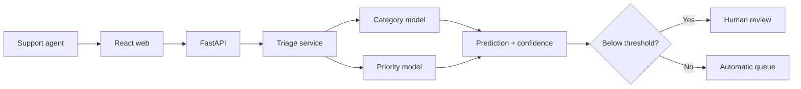

# Architecture

The first release is intentionally a modular monolith. The category and priority models are
versioned together in one artifact so that an API response can always be traced to a complete
model release.

## Boundaries

- `data.py` owns the training data contract.
- `model.py` owns training, evaluation, persistence, and loading.
- `service.py` owns inference and confidence-aware routing.
- `api.py` exposes versioned HTTP contracts.
- `apps/web` is a stateless client and never contains model logic.

## Current limitation

The development dataset is synthetic. It proves software behavior, not model generalization.
The next model milestone will introduce a licensed public dataset and a human-reviewed
Vietnamese challenge set.

